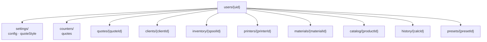

# Diseño de base de datos — Firebase (plan gratuito)

> **Superado en parte por [`modelo-de-datos.md`](modelo-de-datos.md) (2026-11-03).** La estructura ya no cuelga de la persona sino del negocio (D46), con las reglas de seguridad, los índices, los estados, los pagos y la cuota al día. Aquí siguen valiendo §1, §4 (el folio), §8 (sin conexión) y §9 (migrar por pasos). Dos datos de este documento ya no son ciertos: la transferencia de Firebase Hosting es de 10 GB al mes, no 360 MB al día (§7), y `js/sync.js` se quitó en v101 (§7 y §10). Qué cambió, en `modelo-de-datos.md` §1.

Escrito para leerse de principio a fin, no como referencia suelta.

**Diagrama:** [`diagrama-base-de-datos.svg`](diagrama-base-de-datos.svg)

---

## 0. El alcance: primero autenticación

La necesidad concreta es **que la app tenga cuentas de usuario**. Eso lo resuelve Firebase
Authentication, que es un servicio aparte de la base de datos y se puede usar solo.

Pero las cuentas abren una pregunta que no existía antes: *si hay un usuario identificado,
¿dónde viven sus datos?* Mientras todo esté en `localStorage`, iniciar sesión no cambia
nada — los datos siguen atados al dispositivo, no a la persona. La autenticación sin datos
en la nube es una puerta con cerradura que no protege ninguna habitación.

Por eso este documento cubre las dos cosas, en este orden:

| Etapa | Qué se gana | Firebase |
|---|---|---|
| **1. Autenticación** | Identidad, pantalla de acceso, preparar lo demás | Auth |
| **2. Datos en la nube** | Multi-dispositivo, respaldo, no perder nada | Firestore |

Puedes detenerte después de la etapa 1 y la app seguirá funcionando exactamente igual que
hoy. La etapa 2 es la que hace que iniciar sesión signifique algo.

### Lo mínimo para la etapa 1

Con solo autenticación necesitas **un documento por usuario**, nada más:

```js
users/{uid}
{
  email: "fvazquez@procomi.com",
  displayName: "Paco",
  createdAt: Timestamp,
  lastLoginAt: Timestamp
}
```

Todo lo que sigue en este documento es la etapa 2, y está diseñado para colgar de ese
mismo `users/{uid}` sin tener que reacomodar nada.

Los detalles de cómo se implementa el inicio de sesión dentro de la app Android están en
[`ANDROID.md`](ANDROID.md) — hay una trampa con el SDK de JavaScript dentro de un WebView
que conviene conocer antes de escribir código.

---

## 1. El cambio de modelo mental

Hoy tu app guarda **diez cajas de zapatos**. Cada una tiene una etiqueta y dentro hay un
texto largo:

```js
localStorage['c3d_quotes']    // un texto con TODAS las cotizaciones
localStorage['c3d_clients']   // un texto con TODOS los clientes
localStorage['c3d_inventory'] // un texto con TODOS los rollos
```

Para cambiar una cotización, la app lee el texto completo, lo convierte en objetos,
modifica uno, lo vuelve a convertir en texto y reescribe la caja entera. Con 20
cotizaciones funciona perfecto. Es lo que hace `sv()` en [`js/store.js`](../js/store.js).

Firestore es **un archivero**. Cada cotización es su propia carpeta con su propio nombre.
Puedes sacar una sin tocar las demás, y dos dispositivos pueden editar carpetas distintas
al mismo tiempo sin pisarse.

Ese es todo el cambio de fondo. El resto son detalles.

| | localStorage | Firestore |
|---|---|---|
| Unidad | Una llave = todo un array | Un documento = un registro |
| Escribir | Reescribe el array completo | Escribe solo ese documento |
| Dos dispositivos | El último que escribe gana, se pierde lo otro | Cada uno escribe lo suyo |
| Buscar | Cargar todo y filtrar en JavaScript | Consultar al servidor |
| Si pierdes el teléfono | Pierdes todo | No pierdes nada |

---

## 2. La estructura propuesta



Todo cuelga de `users/{uid}`. Esa decisión tiene una razón concreta: las reglas de
seguridad se vuelven **una sola línea**. Si las colecciones estuvieran en la raíz,
tendrías que verificar la propiedad documento por documento y es fácil equivocarse y
dejar los datos de todos expuestos.

---

## 3. Las colecciones, una por una

### `users/{uid}/settings/config`

Documento único con toda la configuración. No es una colección porque solo hay uno.

```js
{
  // Negocio
  bizName: "La Casita del Molde",
  bizPhone: "", bizEmail: "", bizSocial: "", bizQrUrl: "",
  bizBank: "", bizAccountHolder: "", bizAccountNumber: "",
  showBankInfo: true,

  // Costos operativos
  currency: "$",
  kwhCost: 1.20,
  laborCostPerHour: 50,

  // Gastos fijos
  fixedMonthlyCost: 1860,
  fixedCostItems: [
    { name: "Contaduría", amount: 500 },
    { name: "Internet",   amount: 560 },
    { name: "Gasolina",   amount: 500 },
    { name: "Luz",        amount: 200 },
    { name: "Gemini",     amount: 100 }
  ],
  monthlyPrintHours: 200,

  // Gastos indirectos
  indirectMonthlyCost: 450,
  indirectCostItems: [],

  // Porcentajes
  wastePercent: 10,
  maintenancePercent: 5,

  // Resina y AMS
  resinSupportPct: 20, ipaMlPerPrint: 150, ipaLiterCost: 80,
  amsPurgeGrams: 0.7,

  updatedAt: Timestamp
}
```

**Por qué los arrays `fixedCostItems` van embebidos** y no como subcolección: siempre se
leen junto con el resto de la configuración, nunca se consultan por separado, y son cinco
elementos. Hacerlos subcolección significaría cinco lecturas extra cada vez que abres
Ajustes, a cambio de nada.

La regla general: **embebe lo que siempre viaja junto y es poco; separa lo que crece sin
límite o se consulta solo.**

### `users/{uid}/quotes/{quoteId}`

La colección más importante.

```js
{
  quoteNum: "COT-0002",
  quoteDate: Timestamp,
  status: "pendiente",        // pendiente | enviada | aceptada | rechazada

  clientId: "abc123",         // referencia al cliente
  clientName: "Rosalía M.",   // COPIA del nombre — ver nota abajo
  clientPhone: "",

  notes: "",

  items: [                    // embebidos, no subcolección
    {
      desc: "Herradura decorativa",
      printer: "Bambu Lab A1 + AMS",
      material: "PLA",
      weight: 7.66, timeH: 0.2804, designH: 0, margin: 50,
      matCost: 2.68, energyCost: 0.05, laborCost: 0,
      deprecCost: 0.67, fixedCost: 2.61, indirectCost: 0.63,
      maintCost: 0.30, postProcCost: 0, wasteCost: 0.69,
      baseCost: 7.6383, totalCost: 15,
      spoolId: "", qty: 8
    }
  ],

  subtotal: 325, discount: 0, discountAmt: 0,
  commission: 0, commissionAmt: 0,
  grandTotal: 325,
  totalBaseCost: 179.24,

  createdAt: Timestamp, updatedAt: Timestamp
}
```

**Dos decisiones que vale la pena entender:**

**Los `items` van embebidos.** Una cotización nunca tiene cientos de partidas, siempre se
leen completas, y nadie pregunta "dame todas las partidas de todas las cotizaciones". Si
fueran subcolección, abrir la lista de cotizaciones costaría una lectura por partida.

**Se guarda `clientName`, no solo `clientId`.** Esto se llama *desnormalizar* y en una
base de datos tradicional sonaría a error. Aquí es correcto y por dos razones: para
mostrar la lista de cotizaciones no necesitas ir a buscar cada cliente (ahorra lecturas),
y si el cliente cambia de nombre, **la cotización vieja debe conservar el nombre con el
que se emitió**. Es un documento histórico, no una vista en vivo.

Lo mismo aplica a los costos dentro de `items`: son una **fotografía del costo al momento
de cotizar**. Si mañana sube el PLA, COT-0002 sigue diciendo lo que costó entonces. Tu app
ya funciona así, solo hay que conservarlo.

### `users/{uid}/clients/{clientId}`

```js
{
  name: "Rosalía M.", phone: "", email: "", social: "",
  notes: "", source: "cotización", tag: "nuevo",

  // Campos derivados, actualizados al guardar una cotización
  quoteCount: 3,
  totalQuoted: 1225,
  lastQuoteAt: Timestamp,

  createdAt: Timestamp
}
```

Los tres campos derivados existen para que la lista de clientes no tenga que leer todas
las cotizaciones de cada uno. Es el mismo intercambio de siempre: **guardas un dato
repetido para ahorrar lecturas.**

### `users/{uid}/inventory/{spoolId}`

```js
{
  material: "PLA", brand: "", color: "Cian", colorHex: "#00BCD4",
  totalG: 1000, remainingG: 848,
  costPerKg: 350,
  purchasedAt: Timestamp, updatedAt: Timestamp
}
```

### `users/{uid}/printers/{printerId}` y `materials/{materialId}`

Igual a como están hoy. Son catálogos pequeños y estables.

```js
// printer
{ name: "Bambu Lab A1 + AMS", power: 150, type: "FDM",
  cost: 12000, lifeHours: 5000, multicolor: true, heads: 4 }

// material
{ name: "PLA", type: "FDM", costPerKg: 350, density: 1.24 }
```

### `users/{uid}/catalog/{productId}`, `history/{calcId}`, `presets/{presetId}`

Traducción directa de lo que ya existe. En `history` conviene poner un límite: hoy el
código recorta a 100 ([`js/calculator.js`](../js/calculator.js)); en Firestore ese recorte
hay que hacerlo explícito o la colección crece para siempre.

### `users/{uid}/counters/quotes`

```js
{ current: 2 }
```

Un documento con un solo número, y es el más delicado de todos. Lo explico aparte.

---

## 4. El problema del folio

Hoy [`js/quotes.js:4`](../js/quotes.js) hace esto:

```js
function nextQuoteNum() {
  quoteCounter++;
  sv('quoteCounter', quoteCounter);
  return 'COT-' + String(quoteCounter).padStart(4, '0');
}
```

Con un solo dispositivo funciona. Con dos, falla: si tu teléfono y tu computadora están
ambos en 7 y cada uno crea una cotización, **las dos se llaman COT-0008**.

Firestore lo resuelve con una operación atómica — el servidor suma, no el cliente:

```js
import { doc, updateDoc, increment, getDoc } from 'firebase/firestore';

async function siguienteFolio(uid) {
  const ref = doc(db, 'users', uid, 'counters', 'quotes');
  await updateDoc(ref, { current: increment(1) });   // el servidor suma
  const snap = await getDoc(ref);
  return 'COT-' + String(snap.data().current).padStart(4, '0');
}
```

`increment(1)` le dice al servidor "súmale uno a lo que tengas", en vez de "ponle 8".
Aunque dos dispositivos lo pidan en el mismo instante, uno recibe 8 y el otro 9.

**Importante para el modo sin conexión:** si creas una cotización sin internet, el folio
no se puede asignar hasta sincronizar. La salida honesta es guardar la cotización con un
folio provisional y asignar el definitivo al reconectar — no inventar un número local que
luego choque.

---

## 5. Reglas de seguridad

Esto es lo que impide que cualquiera lea tus cotizaciones. Va en `firestore.rules`:

```js
rules_version = '2';
service cloud.firestore {
  match /databases/{database}/documents {

    match /users/{uid}/{document=**} {
      allow read, write: if request.auth != null
                         && request.auth.uid == uid;
    }
  }
}
```

Léelo en voz alta: *"para cualquier cosa dentro de la carpeta de un usuario, permite leer
y escribir solo si quien lo pide inició sesión y es ese mismo usuario."*

Esa es toda la seguridad, y es suficiente **porque todo cuelga de `users/{uid}`**. Ese fue
el pago por haber anidado así.

> **Nunca publiques con las reglas en modo de prueba.** Firebase ofrece al crear el
> proyecto una opción que permite leer y escribir a cualquiera durante 30 días. Si se te
> pasa la fecha o la dejas puesta, tus datos de negocio quedan abiertos a internet.

Cuando llegue el portal del cliente harán falta reglas adicionales para permitir lectura
pública de una cotización específica mediante un token. Eso se diseña cuando toque.

---

## 6. Índices

Firestore necesita un índice para cada consulta que combine filtro y orden. Con tus
pantallas actuales:

| Consulta | Para qué pantalla | Índice |
|---|---|---|
| `where status == X` + `orderBy quoteDate desc` | Filtros de Cotizaciones | Compuesto |
| `orderBy quoteDate desc` | Lista completa y recientes | Automático |
| `where quoteDate >= inicioDeMes` + `where status == 'aceptada'` | Dashboard | Compuesto |
| `where clientId == X` | Cotizaciones de un cliente | Automático |

No hace falta escribirlos a mano: la primera vez que corras una consulta sin índice,
Firestore lanza un error en la consola **con un enlace que lo crea**. Es la forma normal
de trabajar.

La búsqueda por texto (cliente, folio, descripción) **no se puede hacer en Firestore**. No
tiene búsqueda de texto completo. Como cargas todas las cotizaciones de todos modos, lo
razonable es seguir filtrando en JavaScript como hoy.

---

## 7. El plan gratuito te queda grande

Límites diarios del plan Spark y tu consumo estimado:

| Recurso | Límite gratis | Tu uso estimado |
|---|---|---|
| Almacenamiento | 1 GiB | 1 000 cotizaciones ≈ 3 MB → **0,3 %** |
| Lecturas | 50 000 / día | Una carga completa ≈ 300 → **165 cargas/día** |
| Escrituras | 20 000 / día | ~50 al día de uso intenso → **0,25 %** |
| Autenticación | Sin costo | 1 usuario |
| Hosting | 10 GB y 360 MB/día | La app pesa menos de 1 MB |

**No vas a tocar los límites por volumen de trabajo.** El riesgo es otro, y es importante:

> ### Lo que sí quema la cuota: escribir en cada tecla
>
> Hoy varios campos guardan con `oninput`, es decir **en cada letra que escribes**. Por
> ejemplo `saveResinParams()` en [`js/calculator.js`](../js/calculator.js) hace
> `sv('config', config)` cada vez que tocas el campo de IPA.
>
> En localStorage eso es gratis. En Firestore, teclear "150" son **tres escrituras**.
> Ajustar cinco campos de configuración un par de veces al día son cientos de escrituras
> sin que hayas hecho nada.
>
> La solución se llama *debounce*: esperar a que dejes de escribir —medio segundo— y
> recién entonces guardar. Tu código ya tiene un ejemplo de esa técnica en
> [`js/sync.js:13`](../js/sync.js), `schedulePush()`.

Dos puntos a verificar cuando crees el proyecto, porque Google los ha movido y no quiero
que te lleves una sorpresa:

- **Cloud Functions** requiere plan de pago (Blaze) desde hace un tiempo. No lo
  necesitas para lo que vas a construir, pero sí para el portal del cliente más adelante.
- **Cloud Storage** (archivos: tu logo, fotos de piezas) también pide Blaze en proyectos
  nuevos. Mientras tanto el logo puede seguir guardándose como texto en el documento de
  configuración, que es lo que hace hoy.

Blaze tiene cuota gratuita mensual antes de cobrar, pero exige tarjeta. Conviene poner un
límite de presupuesto el día que lo actives.

---

## 8. Modo sin conexión

Esto es lo que hace que valga la pena, y es casi gratis de activar:

```js
import { initializeFirestore, persistentLocalCache } from 'firebase/firestore';

const db = initializeFirestore(app, {
  localCache: persistentLocalCache()
});
```

Con eso Firestore guarda una copia local. La app abre instantánea aunque no haya internet,
puedes cotizar en el taller sin señal, y al reconectar sube los cambios solo.

Es exactamente el comportamiento que tienes hoy con localStorage, pero además respaldado y
compartido entre dispositivos. **No pierdes nada de lo que ya funciona.**

---

## 9. Cómo migrar sin romper nada

El error clásico es cambiar todo de golpe y pasar una semana sin app funcionando. Por
pasos:

**Paso 1 — Una capa intermedia.** Hoy todo el código llama a `ld()` y `sv()`. Si creas
funciones `cargar()` y `guardar()` que por dentro siguen usando localStorage, la app no
cambia en nada, pero queda un solo lugar que tocar después. Es el paso más aburrido y el
más importante.

**Paso 2 — Firebase en paralelo.** Conectas Firestore y escribes en los dos lados. La app
sigue leyendo de localStorage. Si Firebase falla, no pasa nada.

**Paso 3 — Subir lo que ya tienes.** Un script que toma el respaldo JSON
([`backups/`](../backups/)) y crea los documentos. Se corre una vez.

**Paso 4 — Cambiar la lectura.** Ahora `cargar()` lee de Firestore. Un solo archivo
cambia.

**Paso 5 — Quitar localStorage** de la capa intermedia, cuando lleves semanas sin
problemas.

En cualquier paso puedes detenerte y la app sigue funcionando. Eso es lo que buscas
cuando estás aprendiendo: **nunca quedar atrapado con algo a medias.**

---

## 10. Antes de migrar, dos cosas

**Apaga la sincronización con Notion.** Tener dos sistemas de sincronización a la vez es
la receta para perder datos, y el actual ya tiene un problema serio descrito en la
auditoría.

**Arregla primero lo que ya está mal.** Migrar errores a una base de datos nueva solo los
hace más difíciles de corregir. La auditoría tiene el orden sugerido.
