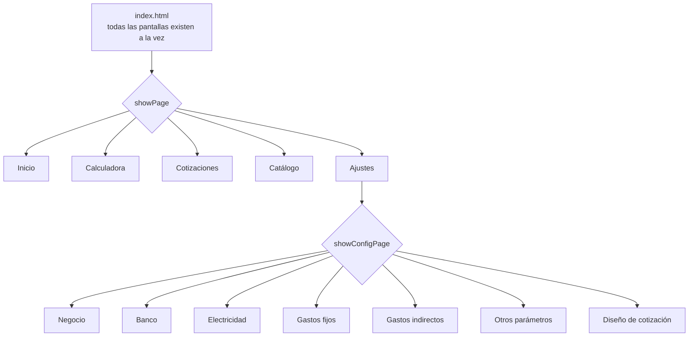
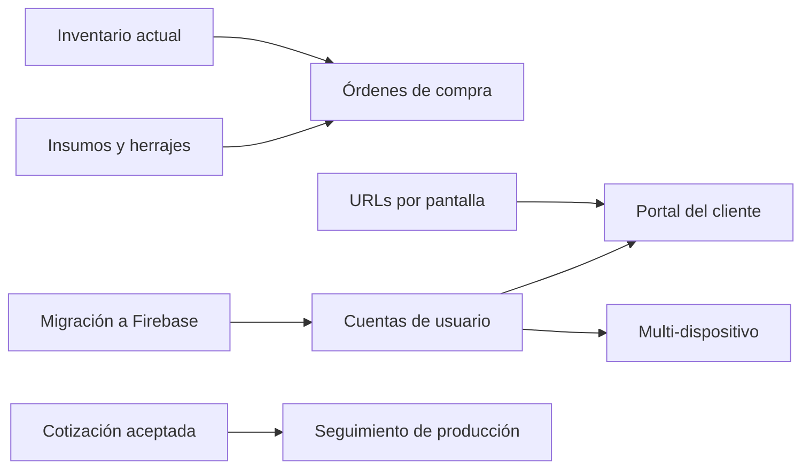

# Mapa de sitio — Calculadora 3D

Qué existe hoy en la app y qué se puede construir encima. Cada pantalla indica el archivo
que la controla, para que puedas ir del mapa al código sin buscar.

**Diagrama:** [`diagrama-mapa-de-sitio.svg`](diagrama-mapa-de-sitio.svg)

---

## Cómo está armada la navegación

La app es **una sola página HTML** (`index.html`, 1281 líneas) donde todas las pantallas
existen al mismo tiempo en el DOM. `showPage(nombre)` esconde unas y muestra otras — no
hay cambio de URL ni recarga.



**Consecuencia de diseño que conviene que sepas:** como no hay URLs, no puedes mandarle a
un cliente un enlace a una cotización específica, ni el botón "atrás" del teléfono hace lo
que la gente espera. Es la limitación más grande de la arquitectura actual y está en la
lista de lo que se puede añadir.

**Barra lateral** (solo en escritorio; al día con v108, D118, D122, D123): arriba, el logo de
Ajustes › Diseño y el nombre del negocio · Negocio (Dashboard, Calculadora, Cotizaciones,
Historial) · Catálogo (Impresoras, Materiales, Inventario, Clientes) · Cuenta (Ajustes, y
debajo el interruptor de modo oscuro) · abajo, la cuenta y «Cerrar sesión». En el teléfono no
hay barra lateral: el tema y «Cerrar sesión» están en Ajustes › Otros. El tema se guarda en
cada navegador y empieza en automático.

---

## Lo que existe hoy

### Acceso e introducción
`js/auth.js` · `js/onboarding.js` · `css/onboarding.css`

Capa que cubre la app (`#auth-gate`) hasta que hay sesión y el usuario vio la
introducción. Una sola función, `_actualizarGate()`, decide qué se muestra:

```
¿hay sesión?  ──no──→  Pantalla de acceso
     │ sí
     ↓
¿vio la intro? ──no──→  Introducción (5 pasos)
     │ sí
     ↓
                        La app
```

**Acceso** — correo y contraseña, Google, o entrar sin cuenta. La sesión es **simulada**:
no hay servidor, cualquier correo con una contraseña de 6 caracteres entra. Lo que importa
es que `auth.js` expone exactamente las mismas funciones que Firebase Authentication
(`signInWithEmailAndPassword`, `signInWithGoogle`, `onAuthStateChanged`, `signOut`) y
devuelve el mismo objeto de usuario. Conectar Firebase será reemplazar el cuerpo de esas
funciones, sin tocar ninguna pantalla.

**Introducción** — cinco pasos que explican el modelo mental del negocio, no la interfaz:

| Paso | Qué comunica |
|---|---|
| 1 | La app calcula el costo real, no solo el filamento |
| 2 | En una pieza de una hora el material es ~17 % y los gastos fijos ~50 % |
| 3 | Qué configurar, y que las horas de impresión al mes son el dato que más pesa |
| 4 | El flujo: slicer → calculadora → orden → cotización |
| 5 | Al aceptar se descuenta inventario y se recalcula el margen |

El contenido vive en el arreglo `OB_PASOS` de `onboarding.js`, separado del código que lo
pinta. Cambiar un texto, una ilustración o el orden es editar ese arreglo.

Desde **Ajustes → Otros parámetros** se puede volver a ver la introducción y cerrar sesión.

### Inicio (Dashboard)
`js/dashboard.js` · 234 líneas

Panel de métricas del mes en curso.

| Elemento | De dónde sale |
|---|---|
| Ingresos aceptados del mes | Suma de `grandTotal` de cotizaciones con estado `aceptada` |
| Barras de 6 meses | Mismo cálculo, mes por mes |
| Margen y ganancia del mes | Ingresos − `totalBaseCost` |
| Tasa de aceptación | Aceptadas ÷ total de cotizaciones del mes |
| Piezas impresas | Conteo de partidas *(tiene un error, ver auditoría)* |
| Horas de impresión + % de capacidad | Suma de `timeH × qty`, contra `monthlyPrintHours` |
| Cotizaciones recientes | Las 4 más nuevas |
| Pantalla de bienvenida | Se muestra si no hay impresoras o materiales |

### Calculadora
`js/calculator.js` · 866 líneas — **el módulo más denso y el corazón del negocio**

Cálculo de costo en vivo: escribes y el resultado se actualiza sin botón.

- **Sección 01 — Pieza:** descripción, peso, tiempo, horas de diseño
- **Sección 02 — Impresora y material:** filtra materiales según el tipo de impresora
  (FDM / Resina)
- **Bloque Resina** (automático con impresora de resina): % de soportes, lavado IPA,
  curado UV
- **Bloque Multicolor AMS** (automático con impresora multicolor): gramos por color,
  cambios de color, purga por cambio, con hoja de ayuda contextual
- **Sección 03 — Post-procesado:** colores de pintura, primer, barniz, horas de pintado
- **Sección 04 — Margen:** deslizador 0–200 % con ganancia en vivo
- **Resultado:** barra de composición de costos, desglose de 6 a 10 rubros, botón
  "Agregar a orden"
- **Presets:** combinaciones guardadas de impresora + material + margen

### Cotizaciones
`js/quotes.js` · 1154 líneas — **el módulo más grande**

- Orden multi-producto con cantidades por partida
- Estados: borrador, enviada, aceptada, rechazada — con filtros y contadores
- Búsqueda por cliente, folio o descripción de pieza
- Descuento y comisión en porcentaje
- Exportar a **PDF** (pdf-lib), **imagen** (html2canvas) y **texto plano**
- **WhatsApp** con mensaje preformateado
- **QR del negocio** en cada cotización
- Sincronización con **Notion** al aceptar
- **Descuento automático de inventario** al aceptar (si la pieza tiene rollo asignado)
- Duplicar y editar cotizaciones

### Clientes
`js/clients.js` · 402 líneas

CRUD de clientes, autocompletado en el modal de cotización, vista expandible con tabs de
pendientes y aceptadas, total cotizado por cliente, acceso directo a WhatsApp.

### Catálogo
`js/catalog.js` · 522 líneas

Productos guardados en dos modalidades:

1. **Por costo:** precarga peso, tiempo y margen en la calculadora
2. **Por tabla de precios:** precio fijo por tamaño (el caso de los cortadores), con
   extras de diseño y refuerzo

Exporta la lista de precios a Excel (SheetJS).

### Inventario
`js/inventory.js` · 111 líneas

Rollos de filamento con material, marca, color, peso total y restante. Barra de progreso
con alerta cuando queda ≤ 20 %. Botón para descontar gramos a mano.

### Historial
`js/history.js` · 59 líneas

Últimos 100 cálculos guardados, para reutilizar sin recalcular.

### Impresoras y Materiales
`js/printers.js` · 53 líneas · `js/materials.js` · 45 líneas

CRUD simple. Impresora: nombre, watts, tipo, costo, vida útil, multicolor, cabezales.
Material: nombre, tipo, costo por kilo, densidad.

### Ajustes
`js/config.js` · 351 líneas — siete sub-pantallas

Negocio · Banco · Electricidad y trabajo · Gastos fijos · Gastos indirectos ·
Otros parámetros · Diseño de cotización. Más exportar e importar respaldo en JSON.
En escritorio va centrado, y Diseño de cotización lleva la vista previa a la derecha (D116, D117).

### Módulos de soporte

| Archivo | Responsabilidad |
|---|---|
| `js/store.js` | Datos, localStorage, migraciones, redondeo |
| `js/templates.js` | HTML puro — funciones que devuelven texto, sin lógica |
| `js/ui.js` | Navegación, modales, snackbar |
| `js/native.js` | Gestos de arrastre, safe areas, vibración |
| `js/theme.js` | Claro / oscuro / automático |
| `js/sync.js` | Sincronización con Notion *(ver auditoría — tiene un riesgo serio)* |
| `js/quote-editor.js` | Editor visual del diseño de cotización |

---

## Lo que se puede añadir

Ordenado por relación entre valor y esfuerzo. No es una lista de deseos: cada entrada
dice qué problema real resuelve.

### Alto valor, esfuerzo bajo

**Órdenes de compra**
Ya tienes el consumo por material y color en cada cotización, y el `remainingG` de cada
rollo en Inventario. Cruzarlos da qué comprar. Hoy eso se hace a mano.

**Insumos y herrajes**
Imanes, argollas, tornillería, bases de madera. Hoy se disfrazan de "color de pintura"
en post-procesado. Un bloque propio con costo unitario y cantidad lo resuelve.

**Seguimiento de producción**
Estados después de aceptada: en cola → imprimiendo → lista → entregada. Hoy una
cotización aceptada desaparece del radar hasta que la entregas.

**Recordatorio de cotizaciones sin respuesta**
Avisar cuando una cotización lleva X días en borrador. Es la fuente de ingresos más
barata que tienes: clientes que ya pidieron precio.

### Alto valor, esfuerzo medio

**URLs reales por pantalla**
Que `/cotizacion/COT-0042` sea un enlace. Habilita compartir, el botón atrás, y que el
cliente vea su cotización en el navegador sin PDF.

**Calculadora de lotes**
Hoy calculas por pieza. Imprimir 8 herraduras en 4 placas tiene un costo de preparación
distinto a imprimir 8 en una sola placa. La app no modela placas.

**Historial de precios de material**
Cuando sube el PLA, las cotizaciones viejas deben conservar su costo original. Hoy se
conserva por copia, pero no hay forma de ver la evolución.

**Comparador de escenarios**
Ver lado a lado la misma pieza con dos márgenes, dos materiales o dos impresoras.

### Requieren la migración a Firebase

**Cuentas y multi-dispositivo real**
Que el teléfono y la computadora vean lo mismo, sin exportar e importar JSON.

**Portal del cliente**
Un enlace donde el cliente ve su cotización y la acepta o rechaza él mismo. Cambia la
tasa de aceptación porque elimina el paso de "te mando el PDF y espero".

**Respaldo automático**
Hoy si pierdes el teléfono, pierdes todo salvo que hayas exportado a mano.

### Más adelante

- Catálogo público con precios, alimentado por tu catálogo interno
- Reportes trimestrales y anuales, no solo del mes
- Costeo por cliente: quién deja más margen
- Publicación en Google Play vía PWABuilder
- Lectura directa del G-code para extraer peso y tiempo sin teclearlos

---

## Dependencia entre lo nuevo

Algunas cosas no se pueden hacer hasta tener otras. Esto importa para decidir el orden:



El camino corto es **Insumos → Órdenes de compra**: dos piezas que se apoyan en lo que ya
existe y resuelven algo que hoy haces a mano.

El camino largo es **Firebase → Cuentas → Portal del cliente**, que es donde está el
cambio de fondo, pero pasa por reescribir cómo la app guarda datos.
